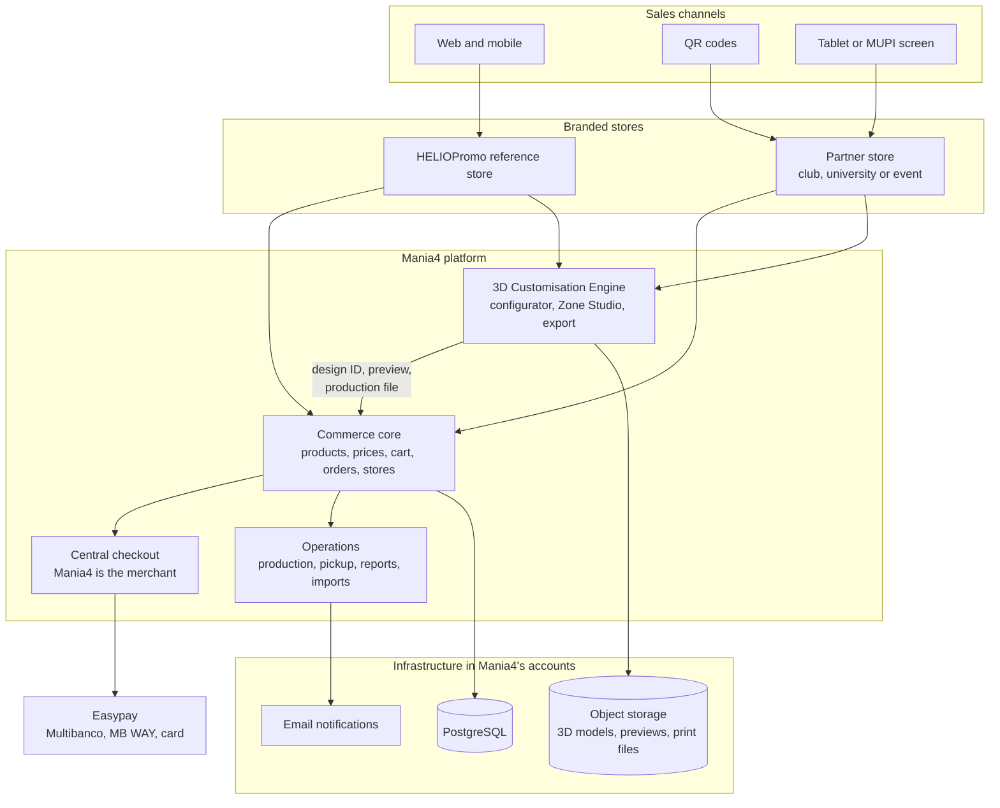

# Mania4 Commerce Platform — Phase 1: Commercial MVP

**Proposal for HELIOtextil Group · HELIOPromo · Mania4**

| | |
| --- | --- |
| Prepared for | André Catalão, CMO, HELIOtextil Group |
| Prepared by | Rodrigo Barona |
| Date | November 2026 |
| Version | 1.1, draft for review |
| Phase 1 investment | €49,500, excluding VAT, fixed price |
| Duration | 10 to 14 weeks |
| Commercial model | Partnership (lower price plus a fee per order) or Standard (one-off price) |

This is the full written version of the Phase 1 proposal. The client deck
(`deck/Mania4-Phase1-Proposal.pptx`) is the short version of the same content.
If the two ever disagree, this document is the reference.

---

## Contents

1. [Executive summary](#1-executive-summary)
2. [Context](#2-context)
3. [Business objectives](#3-business-objectives)
4. [Operating model](#4-operating-model)
5. [Solution: two existing foundations](#5-solution-two-existing-foundations)
6. [What is reused and what is built](#6-what-is-reused-and-what-is-built)
7. [Architecture](#7-architecture)
8. [The pilot scenario](#8-the-pilot-scenario)
9. [Scope of work: six workstreams](#9-scope-of-work-six-workstreams)
10. [Production workflow](#10-production-workflow)
11. [Deliverables](#11-deliverables)
12. [Acceptance criteria](#12-acceptance-criteria)
13. [Delivery plan and milestones](#13-delivery-plan-and-milestones)
14. [Investment](#14-investment)
15. [Commercial model: Partnership or Standard](#15-commercial-model-partnership-or-standard)
16. [Ownership, intellectual property and licensing](#16-ownership-intellectual-property-and-licensing)
17. [Assumptions and client dependencies](#17-assumptions-and-client-dependencies)
18. [Out of scope for Phase 1](#18-out-of-scope-for-phase-1)
19. [Risks and mitigations](#19-risks-and-mitigations)
20. [Governance and team](#20-governance-and-team)
21. [Rollout after launch](#21-rollout-after-launch)
22. [Run and operate](#22-run-and-operate)
23. [Next phases](#23-next-phases)
24. [Next steps](#24-next-steps)
25. [Glossary](#25-glossary)

---

## 1. Executive summary

HELIOtextil wants Mania4 to sell personalised merchandise through its own
branded store and through dedicated stores for football clubs, universities,
festivals and event partners. Every sale goes through one Mania4 checkout,
production goes to HELIOtextil, and the partner only hands the product over.

**Phase 1 delivers a complete, working commercial journey, not a prototype.**
A customer enters a store, personalises a product in 3D, pays, and collects
it or has it delivered. Mania4 receives the order and the production files,
HELIOtextil produces it, and the partner sees what it sold.

### Phase 1 at a glance

| | |
| --- | --- |
| **Investment** | €49,500 excluding VAT (€60,885 with 23% VAT) |
| **Duration** | 10 to 14 weeks |
| **Stores** | 2 pilot stores: the HELIOPromo reference store and one partner store |
| **Languages** | Portuguese and English, ready for international sales |
| **Catalogue** | 5 to 10 products |
| **3D personalisation** | 1 product family, with colours, text, names, numbers and a logo |
| **Payments** | Easypay: Multibanco, MB WAY and card |
| **Channels** | Desktop, mobile and tablet, reached by link or QR code |

### What Phase 1 includes

- The HELIOPromo reference store, selling under Mania4.
- One branded partner store, built from the same template.
- Both stores in Portuguese and English.
- One shared catalogue, order and customer infrastructure for every store.
- A central Mania4 checkout with Easypay.
- 3D personalisation for one agreed product family.
- Design previews from several angles, and production artwork attached to
  each order.
- Order and production management for the Mania4 team.
- Collection by pickup code or QR code, and home delivery.
- Partner sales reports and member discount imports.
- Support during the first partner activation.

### Two ways to pay

| | **Partnership** (recommended) | **Standard** |
| --- | --- | --- |
| Phase 1 | €49,500 | €49,500 |
| Platform licence | Paid through a success fee of €0.40 per paid order | €25,000 one-off |
| Total upfront | **€49,500** | **€74,500** |
| Ongoing | €0.40 per order, invoiced once a year, capped at €36,000 a year, with a buy-out at any time | No fee per order |

Mania4 owns its data and accounts in both models, and neither has a
subscription. The Partnership model costs less unless the platform processes
more than 62,500 orders in total, and by then the business is succeeding.
Section 15 has the details.

### Why this is achievable at this price

Phase 1 is built on two foundations that already exist:

1. **A commerce platform** with multi-store support, catalogue, cart,
   hosted checkout, Portuguese payment providers, orders, a management
   dashboard, user permissions and custom domains.
2. **A 3D customisation engine** with a real-time 3D configurator, a texture
   engine, text, number and logo zones, and a visual tool for defining
   personalisation zones on each product.

The investment goes into connecting the two, finishing the parts of the 3D
engine that are still proof of concept, and building the workflows that are
specific to Mania4: production, pickup, partner reporting and member
discounts. Nothing is rebuilt that already works.

---

## 2. Context

HELIOtextil Group brings decades of textile production: labels, transfers,
emblems, lanyards, sports equipment and promotional products. HELIOPromo
positions this as next-generation merchandise. Identity FC already applies
it to football. Mania4 is the company that sells to the public.

In the meeting of 28 May 2026 we agreed the shape of the opportunity:

- **It is an application, not a website.** One platform that can be
  replicated as many branded stores, on the web, on tablets and on MUPI
  screens.
- **Mania4 sells.** HELIOPromo and HELIOtextil cannot sell retail under the
  current protocol, so every sale is made and invoiced by Mania4.
- **One checkout for everything.** Like a large marketplace, every store has
  its own name and domain, but payment always runs through the same Mania4
  checkout. This keeps one payment contract, one bank relationship and the
  combined volume to negotiate better fees.
- **Partners don't handle money.** The club, university or event receives a
  notification and validates a pickup code, much like a delivery app. The
  accounts are settled at the end of the month.
- **Personalisation is the differentiator.** Customers choose colours, names,
  numbers and logos on a 3D product, and the system produces the file for
  production.
- **HELIOtextil keeps control.** The application, the database and the
  configuration run in Mania4's own accounts, with no SaaS subscription for
  the commerce engine.
- **Two funding lines, one platform.** For the internationalisation project,
  the work is described as two budget lines: the HELIOPromo commerce
  presence, and the replicable sales platform for client projects.

Since that meeting, the approach has been sharpened into a first phase that
proves the business with real orders before scaling it. Phase 1 focuses on
one reference store, one partner store and one 3D product family, and leaves
self-service, deeper integrations and hardware for later phases.

---

## 3. Business objectives

Phase 1 succeeds when Mania4 can:

1. **Sell** through the HELIOPromo store and one partner store, in Portuguese
   and English, taking real payments through one Mania4 checkout.
2. **Personalise** one product family in 3D, with the design captured exactly
   as the customer saw it.
3. **Produce** from production-ready files attached to each order, without
   re-keying anything.
4. **Fulfil** by pickup code at a partner location, or by delivery.
5. **Reconcile** with the partner using sales and redemption reports.
6. **Demonstrate** the full journey to the next clubs, universities, festivals
   and events, and replicate it without a new build.

---

## 4. Operating model

| Party | Role on the platform |
| --- | --- |
| **Mania4** | Merchant of record. Owns the checkout, payments, invoicing, customer relationship and order data. Operates the platform. |
| **HELIOPromo** | The reference brand store. Always online, it shows the offer and sells under Mania4. |
| **Partner** (club, university, event) | Has its own branded store on its own address, with a selected catalogue. Receives order notifications, validates pickup codes in a light back office and never handles payment. |
| **HELIOtextil production** | Receives production files with each order and updates the production status. |
| **Customer** | Buys online, by QR code or on a tablet. Pays Mania4 and collects or receives the product. |

**Money flow.** The customer pays Mania4 through Easypay. Mania4 issues the
invoice. At the end of the month, Mania4 and each partner settle the accounts
using the platform's sales and redemption reports.

**Order flow.** Paid order → Mania4 validates the artwork → HELIOtextil
produces → the customer collects with a code, or the order is shipped →
completed.

---

## 5. Solution: two existing foundations

### 5.1 Commerce foundation

An existing, proprietary, API-first commerce platform. It already provides:

- Many stores on one platform, each with its own data, enforced in the
  database (PostgreSQL row-level security).
- Customer storefront, merchant dashboard and platform administration.
- Product catalogue with variants, categories, stock, VAT and images.
- Cart, coupons and promotions, shipping methods and orders with a full
  status history.
- Hosted, central checkout with payment confirmation by webhook.
- Payment adapters for **Easypay** (Multibanco, MB WAY, card), Ifthenpay and
  Stripe. Payment credentials are encrypted per store.
- Custom domains per store.
- Authentication, organisations, roles and permissions.
- REST API with an OpenAPI specification, used by every application.
- File storage on S3-compatible object storage, and transactional email.

### 5.2 3D Customisation Engine

An existing headless engine for 3D product personalisation, currently a proof
of concept (v0.1). It already provides:

| Capability | Status today |
| --- | --- |
| 3D viewer (React Three Fiber, Three.js, GLB models) | Working |
| Real-time customisation shown on the 3D model | Working |
| Deterministic texture engine, 2048 × 2048 px | Working |
| Base colours, text, names, numbers and logo uploads | Working |
| Zone Studio: visual editor for personalisation zones on the UV map | Working |
| Undo and redo (50 levels) | Working |
| Validated product configuration schema | Working |
| API for product configuration, validation, preview and export | Structure in place, mock data |
| PNG texture export | Working, in the browser |
| Persistent storage, multi-store isolation, cloud asset storage | To build in Phase 1 |
| Server-side production export | To build in Phase 1 |
| Link to the commerce cart and orders | To build in Phase 1 |

The most valuable part is the **Zone Studio**. Instead of programming the
position and rules of every personalisation area by hand, a designer draws
them on the product's texture map and sees the result on the 3D model. That is
what lets the catalogue of personalised products grow without new
development for each product.

---

## 6. What is reused and what is built

| Mania4 need | Starting point | Phase 1 work |
| --- | --- | --- |
| Multiple stores | Reused: stores, data isolation, domains | Mania4 store template and configuration |
| Storefront | Reused: storefront application | HELIOPromo and partner branding, merchandising, content, English version |
| Product catalogue | Reused: products, variants, categories | Personalisation options on products |
| Cart | Reused: cart and API | Attach the customer's design to the cart item |
| Checkout | Reused: hosted central checkout | Configure the Mania4 Easypay account |
| Portuguese payments | Reused: Easypay adapter | Configure and test Multibanco, MB WAY and card |
| Management | Reused: merchant dashboard | Production screens and filters across stores |
| Users and permissions | Reused: authentication and roles | Mania4 operator and partner roles |
| Domains | Reused: custom domains | HELIOPromo and partner addresses |
| 3D configurator | Reused: 3D engine PoC | Integration, persistence, product setup, multi-angle views |
| Zone authoring | Reused: Zone Studio | Internal Mania4 tool, saved to the database |
| Production export | Partly reused: texture engine | Server-side export, storage, order link |
| Production workflow | New | Production statuses, artwork check |
| Pickup | New | Pickup codes, QR and manual validation |
| Partner reconciliation | New | Sales, redemption and product reports, CSV export |
| Member discounts | Partly reused: coupons and promotions | Member list import and eligibility check |

The principle: **the commerce core stays generic and intact**, and Mania4's
specific needs are built on top of it. That keeps the platform maintainable
and lets Mania4 benefit from future improvements to the foundations.

---

## 7. Architecture

### Who owns which data

- **The commerce core** is the source of truth for product names,
  descriptions, prices, SKUs, stock, customers and orders.
- **The 3D engine** owns the 3D models, texture maps, personalisation zones,
  rules and each saved design.
- **An order line references a design** by its ID, preview images and
  production files. The engine never keeps a second copy of the catalogue.

### Technology

| Layer | Choice |
| --- | --- |
| Applications | Next.js and React, responsive for desktop, tablet and mobile |
| 3D | Three.js with React Three Fiber, GLB models |
| Database | PostgreSQL (Neon), with per-store data isolation |
| File storage | S3-compatible object storage (for example Cloudflare R2) |
| Checkout sessions | Redis (Upstash) |
| Hosting | Vercel |
| Email | Resend |
| Payments | Easypay |

All services run in accounts owned by Mania4. They can be changed later
without rewriting the applications.

---

## 8. The pilot scenario

Phase 1 is judged against one complete scenario. Take a football club:

1. The club gets its own branded Mania4 store.
2. Supporters reach it by QR code or by link.
3. A supporter chooses the club shirt.
4. They choose colours, enter their name and number, and add the club logo.
5. The platform shows the result in 3D and saves the design.
6. They pay online through the Mania4 checkout.
7. Mania4 receives the order with the preview and production files.
8. HELIOtextil produces the shirt.
9. The supporter collects it at the club shop by showing a pickup code.

The same journey works for a university, a festival or a corporate event.
Once it works end to end, it can be shown to every next partner.

---

## 9. Scope of work: six workstreams

### Workstream 1 — Platform setup and adaptation

Set up Mania4 on the existing commerce foundation. No new commerce engine is
developed.

- Create the Mania4 production and staging environments, in Mania4's own
  service accounts.
- Configure Mania4 as the operating organisation and merchant of record.
- Configure the HELIOPromo reference store.
- Configure one partner store from the same template.
- Brand each store: name, logo, colours and content.
- Configure each store's catalogue from the shared product base.
- Configure each store's address (domain or subdomain).
- Set up roles and permissions: Mania4 administrator, Mania4 operator and
  partner operator.

### Workstream 2 — Customer storefront

One reusable Mania4 store template, used by both pilot stores.

- Home page and basic content pages (about, contacts, legal pages).
- Product listing and category pages.
- Product pages with options and variants (size, colour).
- Cart, checkout handoff and order confirmation.
- "Buy as is" or "Personalise" on personalisable products.
- Delivery or in-store pickup, configured per store.
- Responsive for desktop, tablet and mobile.
- **Portuguese and English**, with a language switch, translated product
  data and English customer emails.
- Basic analytics.

### Workstream 3 — 3D personalisation and production export

Integrate and productionise the existing 3D Customisation Engine for one
product family.

- Open the 3D configurator from the product page of personalisable products.
- Interactive 3D view: rotate, zoom and inspect.
- Choose from predefined colours.
- Add text, names and numbers, with fonts and limits set per product.
- Upload one logo inside a defined personalisation zone, with file checks.
- Save the product setup and zones in the database instead of the browser.
- Use the Zone Studio as an internal Mania4 tool to set up the pilot product.
- Save each design with a unique ID and a validated configuration.
- **Generate four views of the personalised product (front, back and both
  sides)** for the cart, the order and the confirmation email.
- Generate the production artwork on the server for one agreed production
  template, and store it securely.
- Attach the design to the cart line and the order.

Depends on HELIOtextil providing the 3D model, its UV map and the production
specifications of the chosen product family (see section 17).

### Workstream 4 — Order and production management

Adapt the existing management dashboard for Mania4's operations.

- See orders across all stores, filtered by store and status.
- See customer details and delivery or pickup choice.
- See each order line's personalisation: design views and values.
- Download the production files.
- Move orders through the production statuses (section 10).
- Generate a pickup code for each pickup order, shown as a QR code to the
  customer.
- Validate a pickup by scanning the QR code or typing the code, in a light
  partner screen that works on a phone or tablet browser.

### Workstream 5 — Payments and notifications

- Configure Mania4's Easypay account: Multibanco, MB WAY and card.
- Configure and test payment webhooks.
- Handle successful, pending, failed and expired payments.
- Record refunds and show their status.
- Order confirmation email to the customer, with the design views.
- New-order notification to Mania4 and to the partner.
- Production and "ready for collection" notifications, with the pickup code.
- Export of order and invoice data for Mania4's certified invoicing software.

### Workstream 6 — Partner reporting and member imports

- Import a member list from a CSV file, with column mapping.
- Simple member discount: a member gets the agreed discount after checking
  their member number.
- Sales report by store and period.
- Products and quantities sold.
- Orders and pickups (redemptions) report.
- CSV export for monthly reconciliation with each partner.
- Platform activity report: paid orders per month, used for the success fee
  in the Partnership model.

There are no automatic partner payouts and no accounting system in Phase 1.

### Launch and first activation

- Production launch of both stores.
- Two days of support during the first partner activation (for example the
  first club match day or university event), remote or on site in the Lisbon
  area.

---

## 10. Production workflow

| # | Status | What happens | Who acts |
| --- | --- | --- | --- |
| 1 | **Order received** | Payment confirmed by Easypay. Mania4 and the partner are notified. | System |
| 2 | **Pending production** | A Mania4 operator checks the order and the artwork. | Mania4 |
| 3 | **In production** | HELIOtextil downloads the production files and produces. | HELIOtextil |
| 4 | **Ready for collection** or **shipped** | The customer is notified, with the pickup code if they collect. | Mania4 or HELIOtextil |
| 5 | **Completed** | The pickup is validated by code, or the delivery is confirmed. | Partner or Mania4 |

Orders can also be **cancelled** or **refunded** from any status before
completion, with the reason recorded. Every status change is logged with who
made it and when.

---

## 11. Deliverables

**Platform**

- Mania4 production and staging environments, in Mania4's accounts.
- HELIOPromo reference store, live on its production address, in Portuguese
  and English.
- One partner store, live on its production address, in Portuguese and
  English.
- Reusable store template, documented so the next store is configuration
  work.

**3D personalisation**

- 3D configurator on the pilot product family's product pages.
- Zone Studio available to Mania4 administrators.
- Saved designs with ID, four views, configuration and production file.

**Operations**

- Order and production screens for Mania4.
- Pickup code generation and validation screen for partners.
- Easypay payments configured and tested in production.
- Customer, Mania4 and partner email notifications.
- Member list import, member discount and partner reports with CSV export.

**Documentation and handover**

- Operations guide: creating a store, managing products, handling orders,
  production and pickups, imports and reports.
- Technical guide: environments, services, deployment and configuration.
- Two training sessions: one for Mania4 operators, one for partner staff.
- Support during the first partner activation.
- 30 days of post-launch warranty and support.

---

## 12. Acceptance criteria

Phase 1 is accepted when, in production:

1. A customer can enter either pilot store, choose a product, personalise it
   in 3D where available, pay by Multibanco, MB WAY or card, and receive a
   confirmation email with the design views.
2. A Mania4 operator can see the order, open the design, download the
   production files and move the order through every production status.
3. A partner operator can validate a pickup with the QR code or the typed
   code, and the order is marked as completed.
4. A member from an imported list gets the agreed discount, and a non-member
   does not.
5. Mania4 can export the partner's sales and pickups for a chosen period.
6. A third store can be configured from the template without code changes,
   using the documented process.
7. Both stores work in Portuguese and English, on current desktop, tablet and
   mobile browsers.

**Quality criteria**

- The main journeys pass functional testing before launch.
- Payment and order status changes are logged and auditable.
- Uploaded logos are checked for file type and size.
- Payment credentials and secrets are never exposed to the browser.
- Each store sees only its own data.
- The production file of the pilot product is validated against a physical
  sample produced by HELIOtextil.

---

## 13. Delivery plan and milestones

The plan below shows the 12-week baseline. The range of 10 to 14 weeks
depends mostly on how quickly the 3D model, production specifications,
Easypay credentials, translations and content are available.

| Weeks | Stage | Main outputs |
| --- | --- | --- |
| 1–2 | **Discovery and technical validation** | Pilot definition workshop. Technical review of both foundations. Confirmed product family, partner, payment account and operating rules. Final backlog. |
| 2–4 | **UX/UI adaptation** | Store template design for HELIOPromo and the partner. Configurator, operator and pickup screens. |
| 3–6 | **Commerce foundation and storefront** | Environments, stores, domains, catalogue, both languages, checkout with Easypay and notifications, working end to end on staging. |
| 5–10 | **3D pilot and operational workflows** | Configurator integrated with cart and orders, design views, production export, production statuses, pickup codes, imports and reports. |
| 10–12 | **Quality, acceptance and launch** | Testing, security review, performance, acceptance testing with Mania4, training, production launch. |
| +30 days | **Warranty and first activation** | Defect correction, launch support, support at the first partner activation. |

| Milestone | When | Accepted when |
| --- | --- | --- |
| **M1 · Kickoff and discovery** | Week 0–2 | Contract signed, kickoff held, discovery report and backlog approved |
| **M2 · Commerce foundation and storefront** | ~Week 6 | Both stores on staging, test payment completed end to end |
| **M3 · 3D pilot and operational workflows** | ~Week 10 | Personalised order from configurator to production file and pickup, on staging |
| **M4 · Acceptance and production launch** | ~Week 12 | Acceptance criteria in section 12 met in production |

If the contract is signed in December 2026, kickoff is in January 2027 and
launch is around the end of March 2027, in time to prepare the summer 2027
event season.

---

## 14. Investment

### 14.1 Fixed price

**€49,500, excluding VAT, for the full Phase 1 scope.**

| | Amount |
| --- | --- |
| Phase 1 | €49,500 |
| VAT (23%) | €11,385 |
| **Total with VAT** | **€60,885** |

VAT is shown at the mainland Portugal standard rate of 23% and applies as
required by law at invoicing. The platform licence is paid separately,
according to the commercial model chosen in section 15.

### 14.2 Two funding lines

For the internationalisation project, Phase 1 can be presented as two budget
lines. They describe one platform, delivered as one project.

| Funding line | What it covers | Amount |
| --- | --- | --- |
| **A · HELIOPromo commerce presence** | The HELIOPromo reference store with online sales in Portuguese and English: discovery, design, platform setup, storefront and catalogue, central checkout with Easypay, notifications, and their share of testing and management. | **€20,000** |
| **B · Replicable sales platform for client projects** | Replicated partner stores, 3D personalisation and production export, production and pickup workflow, partner reporting and member imports, first activation support, and their share of testing and management. | **€29,500** |
| **Total** | | **€49,500** |

The split is indicative and can be adjusted to fit the funding application.

### 14.3 Breakdown by workstream

| Workstream | Line A | Line B | Total |
| --- | ---: | ---: | ---: |
| Discovery and technical validation | €1,350 | €900 | €2,250 |
| UX/UI adaptation | €1,800 | €900 | €2,700 |
| Platform setup and adaptation | €2,250 | €3,150 | €5,400 |
| Storefront and catalogue, in Portuguese and English | €5,850 | — | €5,850 |
| 3D personalisation, design views and production export | — | €8,100 | €8,100 |
| Order and production management | — | €4,500 | €4,500 |
| Payments and notifications | €2,250 | — | €2,250 |
| Partner reporting and member imports | — | €1,800 | €1,800 |
| Quality, security, launch and first activation | €2,250 | €4,050 | €6,300 |
| Project management and technical leadership | €1,800 | €2,700 | €4,500 |
| **Implementation** | **€17,550** | **€26,100** | **€43,650** |
| Delivery risk allowance | €2,450 | €3,400 | €5,850 |
| **Total** | **€20,000** | **€29,500** | **€49,500** |

The risk allowance is part of the fixed price, not an extra charge. It covers
what the technical validation in week 1 to 2 may uncover, so the scope above
can be delivered without reopening the budget.

### 14.4 Payment milestones

| Milestone | % | Amount | VAT (23%) | With VAT |
| --- | ---: | ---: | ---: | ---: |
| M1 · Kickoff and discovery, on signature | 20% | €9,900 | €2,277.00 | €12,177.00 |
| M2 · Commerce foundation and storefront | 30% | €14,850 | €3,415.50 | €18,265.50 |
| M3 · 3D pilot and operational workflows | 30% | €14,850 | €3,415.50 | €18,265.50 |
| M4 · Acceptance and production launch | 20% | €9,900 | €2,277.00 | €12,177.00 |
| **Total** | **100%** | **€49,500** | **€11,385.00** | **€60,885.00** |

In the Standard model, the €25,000 licence is invoiced with M4.

### 14.5 Commercial terms

- **Fixed price** for the scope in this document.
- **Changes** to scope, new requirements or new integrations go through a
  written change request with their cost and time impact, approved before
  work starts.
- **Not included in the price:** third-party running costs paid directly by
  Mania4 (hosting, database, storage, email, domains), Easypay transaction
  fees, the run and operate plan (section 22) and the items in section 18.
- **Running costs** at pilot volumes are estimated during discovery, before
  launch.
- **Acceptance:** each milestone is reviewed within 5 working days of
  delivery. It is accepted if no blocking defect is reported in that time.
- **Validity:** this proposal is valid for 30 days from its date.

---

## 15. Commercial model: Partnership or Standard

Phase 1 is priced well below a build from scratch because it reuses two
existing foundations. Mania4 can pay for the right to use those foundations
in one of two ways. The scope, the ownership of data and accounts, and the
absence of any subscription are the same in both.

### 15.1 The two options

| | **Partnership** (recommended) | **Standard** |
| --- | --- | --- |
| Phase 1 build | €49,500 | €49,500 |
| Platform licence | Paid through the success fee | €25,000, one-off, with M4 |
| **Upfront total** | **€49,500** | **€74,500** |
| Fee per order | €0.40 per paid order | None |
| Improvements to the foundations | Included while the success fee runs | Through the run and operate plan or a project |
| Best for | Starting lean and paying as sales grow | A single, fixed investment, for example inside a funded project |

A one-off investment can be easier to include in a funding application. Check
with the funding consultant which option suits the internationalisation
project best.

### 15.2 How the success fee works

| | |
| --- | --- |
| **Rate** | €0.40 per paid order, whatever the order value or number of items |
| **What counts** | Every order paid through the Mania4 checkout, in any store or channel. Orders fully cancelled or refunded don't count. |
| **Source of the numbers** | The platform's activity report, which Mania4 and the supplier can both see at any time |
| **Invoicing** | Once a year, in January, for the previous calendar year. Quarterly if Mania4 prefers. |
| **Minimum** | None. If nothing sells, nothing is due. |
| **Annual cap** | €36,000 a year (90,000 orders). Above that, orders are free for the rest of the year. |
| **Rate guarantee** | Fixed for 3 years from launch, then updated each year by the Portuguese consumer price index |
| **Buy-out** | Mania4 can end the success fee at any time. The price is €25,000 minus every success fee already paid, but never less than twice the fees of the last 12 months. After buy-out, the licence is fully paid up. |
| **What Mania4 gets in return** | The lower upfront price, every improvement to the commerce platform and the 3D engine at no extra cost, and a technology partner paid on results |

The same buy-out price applies if Mania4 stops using the platform within 3
years of launch.

### 15.3 Compared with the market

What a €40 order would pay in platform and customiser fees, excluding payment
processing and monthly subscriptions:

| Setup | Fees on a €40 order |
| --- | ---: |
| Shopify Basic with a third-party payment provider (2%), plus a 3D customiser app (1.9%) | €1.56 |
| Shopify Grow (1%), plus a 3D customiser app (1.9%) | €1.16 |
| Shopify Advanced (0.6%), plus a 3D customiser app (1.5%) | €0.84 |
| **Mania4 Partnership** | **€0.40** |

Shopify charges its fee when the store uses a third-party payment provider
such as Easypay. Customiser apps such as Zakeke charge between 1.5% and 1.9%
of every personalised sale, on top of a monthly plan. These are public prices
in November 2026 and vary by plan. Mania4 also pays no monthly subscription,
and owns its data and accounts.

### 15.4 When each option pays off

The Partnership costs less until the success fees add up to the €25,000
difference, which is **62,500 orders in total**.

| Orders a year | Success fee a year | Years before the Partnership costs more |
| ---: | ---: | --- |
| 5,000 | €2,000 | 12.5 years |
| 15,000 | €6,000 | about 4 years |
| 30,000 | €12,000 | about 2 years |
| 60,000 | €24,000 | about 1 year |

At 60,000 orders a year, the platform is a substantial business, and Mania4
can still buy out the fee at any time.

### 15.5 Upside for both

- **Referrals.** If Mania4 introduces another company that buys its own
  platform from the supplier, Mania4 receives 15% of that project's first-year
  value.
- **Shared roadmap.** Improvements requested by Mania4 that are useful to other
  clients can be built into the foundations at a shared cost, agreed case by
  case.

### 15.6 The first year, as an example

Partnership model, Growth run and operate plan from the end of the warranty,
and 10,000 orders in the first year:

| Item | Amount, excluding VAT |
| --- | ---: |
| Phase 1 build | €49,500 |
| Run and operate, Growth plan, 8 months | €11,120 |
| Success fee, 10,000 orders (invoiced the following January) | €4,000 |
| Cloud services, paid directly to the providers | about €1,200 to €3,600 |

---

## 16. Ownership, intellectual property and licensing

Phase 1 is fast and affordable because it reuses foundations that existed
before this project. The ownership model protects both sides.

**Mania4 owns**

- All its data: customers, orders, products, designs and reports.
- Its environments and service accounts. The platform runs in Mania4's own
  accounts, so Mania4 controls the database and the infrastructure.
- Its brands, content, product data, 3D models and production assets.
- The bespoke work done for Mania4: its store template, configuration and
  Mania4-specific features.

**Mania4 receives a licence to the foundations**

- A perpetual licence to use the commerce foundation and the 3D
  Customisation Engine for Mania4's own business, including its partner
  stores.
- **No subscription and no fee per store.** In the Partnership model, the
  licence is paid through the success fee in section 15. In the Standard
  model, it is paid once.

**The supplier keeps**

- Ownership of the pre-existing foundations (the commerce platform and the
  3D Customisation Engine), and of generic improvements made to them, so
  they can keep evolving. Mania4 benefits from those improvements.

The exact terms are set in the contract. Customer data is processed under a
data processing agreement in which Mania4 is the controller.

---

## 17. Assumptions and client dependencies

**HELIOtextil and Mania4 provide**

- One product owner at Mania4, with authority to decide, available for a
  weekly meeting and feedback within 3 working days.
- The choice of the pilot product family and the partner for the second
  store, confirmed in discovery.
- **The 3D model (GLB or a convertible format) of the pilot product family,
  its UV map and its production specifications**, and one physical sample to
  validate the production file. The engine currently uses a sample model.
- Product data: names, descriptions, prices, variants, VAT and photographs.
- **English translations** of the content and product data.
- Brand assets and copy for HELIOPromo and the partner store.
- Legal texts: terms of sale, privacy policy, returns policy and cookie
  information, in both languages.
- The Mania4 Easypay merchant account and API credentials, early in the
  project.
- Access to domains and DNS for the store addresses.
- A sample member list and the discount rules for the partner.
- The format the certified invoicing software accepts for imports.

**Assumptions**

- The storefront is in Portuguese and English.
- One payment provider: Easypay.
- One production template for the production file.
- Up to 10 products and 2 stores at launch.
- Delivery uses flat-rate shipping set per store, with no carrier
  integration.
- The existing technical sheet format can be used as the reference for the
  production file.
- The stores work in the browser of a tablet or MUPI screen, but no
  hardware is integrated.

---

## 18. Out of scope for Phase 1

These are excluded unless added by a change request or a later phase:

- Creating new 3D models, UV maps or product photography.
- Automatic 3D models from photos, and virtual try-on.
- More than one 3D product family.
- Self-service store creation by partners.
- ERP, accounting and warehouse integrations.
- Direct API integration with the invoicing software. The export in
  workstream 5 is included.
- Automatic partner settlement, commissions or payouts.
- Partner member APIs and SFTP feeds. CSV import is included.
- Physical payment terminals, MUPI hardware, printers, presses and IoT
  telemetry.
- Native iOS or Android apps.
- Carrier integrations, such as CTT or DPD labels and tracking.
- Languages other than Portuguese and English.
- Hardware purchase, installation and certification.
- Formal legal, tax or GDPR certification.
- Third-party running costs and transaction fees.
- Support and maintenance after the 30-day warranty, covered by the run and
  operate plans in section 22.

---

## 19. Risks and mitigations

| Risk | Impact | Mitigation |
| --- | --- | --- |
| The 3D model, UV map or specifications arrive late or need rework | 3D pilot slips | Product family chosen in week 1. Asset checklist in discovery. 3D work runs after the commerce work so it has time to land. |
| The texture file is not ready for production as is | Rework of the export | Validate against one physical sample before M3. One production template only. |
| Easypay account or credentials take time | Payments can't be tested | Request credentials at kickoff. Use the Easypay test environment until then. |
| Requirements grow during the project | Budget and date at risk | Fixed backlog after discovery. Change requests for anything new. |
| The technical review finds work needed in the foundations | Unplanned effort | Review happens first, in week 1 to 2. Covered by the risk allowance. |
| Content, product data or translations are late | Launch slips | Content checklist with dates at kickoff. The template launches with the data available. |
| Invoicing needs more than an export | Manual work at Mania4 | Confirm the invoicing software and its import format in discovery. Quote an integration separately if needed. |

---

## 20. Governance and team

**Ways of working**

- A kickoff and pilot definition workshop in week 1.
- A 30-minute status meeting every week.
- A demo on staging every two weeks.
- One shared backlog, visible to Mania4.
- One decision-maker on each side.
- Written change requests, approved before work starts.
- Acceptance by milestone, as described in section 13.

**Delivery team**

| Role | Responsibility |
| --- | --- |
| Technical lead and project manager | Single point of contact, architecture, plan, quality |
| Full-stack engineers | Platform, storefront, checkout, operations |
| 3D and front-end engineer | Configurator, Zone Studio, production export |
| UX/UI designer | Store template, configurator and operator screens |
| QA | Test plan, functional and device testing, acceptance support |

---

## 21. Rollout after launch

Phase 1 ends with two stores live. The rollout turns that into a network of
stores, in four waves. Dates assume a signature in December 2026.

| Wave | When | Goal | What happens |
| --- | --- | --- | --- |
| **0 · Launch** | January to March 2027 | Two stores selling | Phase 1: the HELIOPromo store and the pilot partner store go live, with the first activation. |
| **1 · Prove** | April to June 2027 | Show the model works | 3 to 5 more partner stores from the template, using the store set-up service. First event with QR codes. Measure the results below. Phase 2 is built in parallel. |
| **2 · Scale** | July to December 2027 | Grow with less effort | Phase 2 live: store wizard, MUPI kiosk mode, more 3D product families. Summer events and festivals. 10 to 20 stores. |
| **3 · Expand** | 2028 | International and automated | First partner stores outside Portugal, using the English store. Phase 3 integrations and automation. |

### A new partner store in five working days

| Day | Step |
| --- | --- |
| 1 | Partner agreement signed and catalogue chosen |
| 2 | Brand assets received and store set up from the template |
| 3 | Address and QR codes ready, member list imported, pickup point set |
| 4 | Test order end to end, partner staff trained on the pickup screen (30 minutes) |
| 5 | Store launched and announced |

After launch, the partner gets a monthly sales and pickup report, used to
settle the accounts.

### What we measure in Wave 1

- Stores live and orders per store.
- Conversion rate from visit to order.
- Share of orders that are personalised.
- Average order value.
- Production lead time, from paid order to ready.
- Pickup rate and time to pickup.
- Settlement differences with partners (target: none).

These results decide the Phase 2 priorities.

---

## 22. Run and operate

After the 30-day warranty, the platform needs to be kept secure, up to date
and supported, and new stores and products need to be added. Mania4 chooses
one of three plans.

### 22.1 Plans

| | **Essential** | **Growth** (recommended for year 1) | **Scale** |
| --- | --- | --- | --- |
| Monthly fee, excluding VAT | **€690** | **€1,390** | **€2,690** |
| Infrastructure management in Mania4's accounts | ✓ | ✓ | ✓ |
| Monitoring and alerts, 24/7 | ✓ | ✓ | ✓ |
| Security updates and dependency upgrades | ✓ | ✓ | ✓ |
| Daily backups and a restore test each quarter | ✓ | ✓ | ✓ |
| Bug fixes | ✓ | ✓ | ✓ |
| Monthly service report | ✓ | ✓ | ✓ |
| Hours for changes and improvements, each month | 4 | 12 | 30 |
| New partner stores set up, each month | — | 1 | Up to 4 |
| Event-day cover (weekend on-call for activations) | — | — | Up to 4 days a month |
| New 3D product set up | — | — | 1 a quarter |
| Roadmap review | — | Quarterly | Monthly |

Plans run for 12 months and start after the warranty. Unused hours carry over
to the next month only. Mania4 can move up a plan at any time and down at
renewal.

### 22.2 Response times

| Severity | Example | Essential | Growth | Scale |
| --- | --- | --- | --- | --- |
| **Critical** | Checkout or a store is down | 4 business hours | 2 business hours | 1 hour, including event days |
| **High** | A feature fails and there's no workaround | Next business day | 8 business hours | 4 business hours |
| **Normal** | A minor fault or a question | 3 business days | 2 business days | 1 business day |

Business hours are 9:00 to 18:00 Lisbon time, Monday to Friday. The target
availability for stores and checkout is 99.5% a month, excluding outages of
the cloud providers.

### 22.3 Services on demand

Available on any plan, or without a plan:

| Service | Price, excluding VAT |
| --- | ---: |
| New partner store set-up (template, branding, catalogue, address, QR codes, training) | €650 per store |
| New 3D product set-up (model optimisation, zones, production template validation) | €1,800 per product |
| Event activation support, remote | €450 per day |
| Event activation support, on site | €600 per day, plus travel |
| Training session (2 hours, remote) | €350 |
| Additional development | €450 per day |

### 22.4 Cloud running costs

The cloud services run in Mania4's accounts and are paid directly to the
providers: hosting (Vercel), database (Neon), file storage (Cloudflare R2),
checkout sessions (Upstash) and email (Resend). At pilot volumes this is
typically €100 to €300 a month, and it grows with traffic. Easypay fees
follow Mania4's contract with Easypay. The exact estimate is made in
discovery.

---

## 23. Next phases

Phase 1 proves the business with real orders. The next phases are planned
from what the pilot teaches.

| Phase | When | Focus | Indicative scope | Indicative budget |
| --- | --- | --- | --- | --- |
| **Phase 1 · Commercial MVP** | January to March 2027 | Start selling and producing real orders | This proposal | **€49,500** · 10 to 14 weeks |
| **Phase 2 · Scale and self-service** | April to June 2027, ready for the summer | Launch more stores and products with less effort | Store creation wizard for new partners; Zone Studio opened to designers and more 3D product families; richer partner pricing and member rules; more store templates; tablet and MUPI kiosk mode; wider reporting | €15,000 to €25,000 · 5 to 8 weeks |
| **Phase 3 · Integrations and automation** | From late 2027 | Connect the ecosystem | ERP and accounting; invoicing API; SFTP and partner APIs; automatic settlement and commissions; Easypay payment terminal on MUPI; printer and press telemetry; production analytics; AI agent workflows; virtual try-on | Scoped separately |

Phase 2 and 3 figures are planning ranges only. They are confirmed after
Phase 1, once real usage shows what matters most.

---

## 24. Next steps

1. Review this proposal with HELIOtextil and the funding consultant.
2. Choose the commercial model (Partnership or Standard) and the run and
   operate plan.
3. Confirm the funding line split.
4. Choose the pilot product family and the partner for the second store.
5. Sign the Phase 1 contract and schedule the kickoff workshop.
6. Start the Easypay credentials request and collect the 3D model and
   production specifications.

---

## 25. Glossary

| Term | Meaning |
| --- | --- |
| **Merchant of record** | The company that sells to the customer, takes the payment and issues the invoice. Here, Mania4. |
| **Partner store** | A branded store for a club, university or event, running on the Mania4 platform and checkout. |
| **Central checkout** | One payment page shared by every store, operated by Mania4. |
| **3D configurator** | The screen where the customer personalises a product on a 3D model. |
| **Zone Studio** | The internal tool to draw the areas of a product that can be personalised. |
| **UV map** | The flat layout of a 3D product's surface, where the artwork is placed. |
| **GLB** | A standard file format for 3D models on the web. |
| **Production file** | The artwork file generated from the design, used to produce the product. |
| **Pickup code** | The code or QR code a customer shows to collect an order. |
| **MUPI** | A street or in-store digital display, usable as a touch screen kiosk. |
| **Multibanco, MB WAY** | Portuguese payment methods, by ATM or bank reference and by mobile phone. |
| **Success fee** | In the Partnership model, the fee of €0.40 per paid order that pays for the platform licence. |
| **Buy-out** | A one-off payment that ends the success fee and makes the licence fully paid up. |
| **Run and operate** | The monthly service that keeps the platform secure, updated and supported after launch. |
