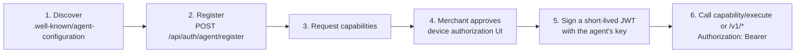
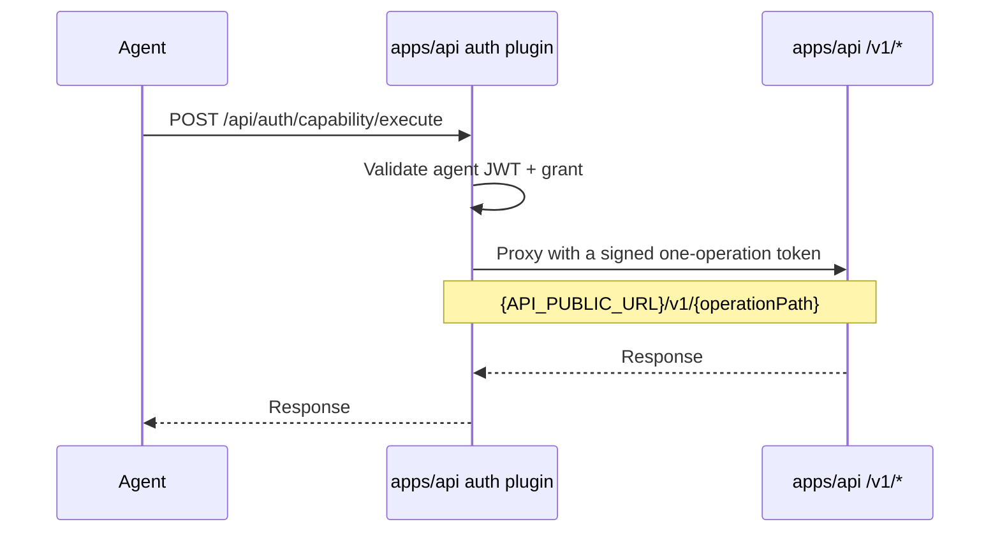

The Commerce API implements [Better Auth Agent Auth](https://www.better-auth.com/docs/plugins/agent-auth) on top of the same OpenAPI contract documented at [Commerce API](/docs/api).

AI agents can discover, register, request capabilities, and call commerce operations with delegated user authority.

## What the merchant decides

With Agent Auth, an AI agent starts with nothing until you approve it for your store. After that it keeps the public catalog, and anything else needs your approval. You see every capability the agent asks for and approve or deny the request as a whole. Approved access ends after an hour idle, or 24 hours at most. Then the agent asks again.

If the agent asks for anything that changes your store (an `admin*` operation that isn't a read, such as a refund, a cancellation or a price change), approving it needs a sign-in from the last 10 minutes. If yours is older, the approval page asks you to sign in again first.

You see every agent approved for your store under **Settings → API keys**, with what it can do and when it was last used, and you can revoke one there right away. The same page shows the store's recent agent activity.

An API key isn't Agent Auth: anything holding an admin key can do what the key allows, without asking.

Agent Auth is coming with Grow. Free keys reach the 21 storefront tools.

## Discovery

Agents load the provider configuration from:

```
GET https://<api-host>/.well-known/agent-configuration
```

Response includes:

```json
{
  "version": "1.0-draft",
  "provider_name": "Prood Commerce API",
  "description": "Multi-tenant commerce HTTP API. ...",
  "issuer": "http://localhost:3005/api/auth",
  "default_location": "http://localhost:3005/api/auth/capability/execute",
  "algorithms": ["Ed25519"],
  "modes": ["delegated", "autonomous"],
  "approval_methods": ["ciba", "device_authorization"],
  "endpoints": {
    "register": "http://localhost:3005/api/auth/agent/register",
    "capabilities": "http://localhost:3005/api/auth/capability/list",
    "describe_capability": "http://localhost:3005/api/auth/capability/describe",
    "execute": "http://localhost:3005/api/auth/capability/execute",
    "request_capability": "http://localhost:3005/api/auth/agent/request-capability",
    "status": "http://localhost:3005/api/auth/agent/status",
    "reactivate": "http://localhost:3005/api/auth/agent/reactivate",
    "revoke": "http://localhost:3005/api/auth/agent/revoke",
    "revoke_host": "http://localhost:3005/api/auth/host/revoke",
    "rotate_key": "http://localhost:3005/api/auth/agent/rotate-key",
    "rotate_host_key": "http://localhost:3005/api/auth/host/rotate-key",
    "introspect": "http://localhost:3005/api/auth/agent/introspect"
  }
}
```

Better Auth routes (registration, capability execute, device approval) are mounted at `/api/auth/*` on the API app (port **3005** in local dev).

## Capabilities from OpenAPI

Every REST operation with an `operationId` in the OpenAPI spec becomes an agent capability:

| Capability | Method | Scope required |
| --- | --- | --- |
| `listProducts` | GET | `storefront` (default, once the agent has a store) |
| `getProduct` | GET | `storefront` (default, once the agent has a store) |
| `addCartItem` | POST | `storefront` (requires approval) |
| `placeOrder` | POST | `storefront` (requires approval) |
| `adminCreateProduct` | POST | `admin` (requires approval) |
| `adminRefundOrder` | POST | `admin` (requires approval) |

An agent starts with nothing it can use. `resolveAgentAccess` refuses an agent with no store: one with no user behind it, or one whose user has several stores and hasn't approved it for one. Once the agent has a store it keeps the public catalog reads (`listProducts`, `getProduct`, `getProductBySlug`, `listCategories`, `getStore`, `listCountries`), the default grants for an agent host. Everything else, including other `GET` operations and every `admin*` operation, requires approval on the dashboard's device authorization page. All the capabilities in a request are approved or denied together. Only store owners and admins can approve a request that includes an `admin*` capability. A request that includes a capability that changes the store (`changesStore` in `@prood/auth/agent-capabilities`: every `admin*` operation except `adminGet*` and `adminList*`) also needs a session started in the last 10 minutes. Approving also binds the agent to the active store. On a Free store, Agent Auth is refused.

When the session ends, after an hour idle (`agentSessionTTL: 3600`) or 24 hours at most (`agentMaxLifetime: 86400`), it reactivates with the catalog defaults only, and the agent has to ask again.

## Agent registration flow



## Calling the REST API directly

When an agent calls `/v1/*` with an `Authorization: Bearer` agent JWT:

1. API validates the JWT signature and expiry
2. Resolves the store: the one the agent was approved for, or the user's only store. A user with several stores must approve the agent for one
3. Checks the agent holds the capability for this exact operation. Holding one `admin*` capability doesn't unlock other admin routes
4. Executes the operation scoped to that store

```bash
curl -H "Authorization: Bearer eyJ..." \
  "https://api.prood.com/v1/products?perPage=5"
```

## OpenAPI proxy execution

When capabilities run through the default execute endpoint, the plugin proxies HTTP to the public API base URL. No API key is stored for this: the proxy checks the agent's store, plan and role, then sends a token signed with a key derived from `BETTER_AUTH_SECRET`. The token lasts a minute and names the store, the agent, the capabilities it holds and the one operation it may reach. `/v1` refuses it on any other operation.



### Required environment variables

| Variable | Purpose |
| --- | --- |
| `API_PUBLIC_URL` | Public API origin used in OpenAPI + proxy. Required |
| `TRUST_PROXY` | Set `true` behind a reverse proxy for JWT `aud` validation |

## Database tables

The Agent Auth tables are defined in `packages/auth/src/schema.ts` and created by `pnpm db:migrate`:

| Table | Purpose |
| --- | --- |
| `agentHost` | Registered agent host applications |
| `agent` | Individual agent instances |
| `agentCapabilityGrant` | Approved capabilities per agent |
| `approvalRequest` | Pending user approval requests |
| `agent_event` | Audit log per store: registrations, approvals, denials, revocations and calls. Never stores arguments or results |

## Audit log

Every Agent Auth event the plugin emits (`onEvent`) is written to `agent_event`, along with the approvals, denials and revocations made in the dashboard and admin, which don't go through the plugin. Calls through the execute endpoint are recorded as `capability.executed` with their outcome and duration. Calls an agent makes to `/v1` with its own token are recorded as `capability.called`. Arguments and results are never stored, because they can hold customer data.

## Security considerations

- Agents operate with **delegated user authority** — they can only access data the approving user can access
- An agent can do nothing until it's approved for a store. After that, everything past the six public catalog capabilities needs explicit approval on the device authorization page
- Agent JWTs are short-lived and scoped to granted capabilities. Access ends after an hour idle, or 24 hours at most
- Tenant isolation applies — agents cannot cross organization boundaries
- Proxied capability execution requires agent metadata with `organizationId`, and `/v1` only accepts the proxy's signed token for the one operation it names

## Stability

`@better-auth/agent-auth` implements a protocol that's still a draft, and its API changes between releases. Its version is pinned exactly in `pnpm-workspace.yaml`, not with a range. Before upgrading, read its changelog, then run the API tests (`agent-execute`, `resolve-caller`, `agent-store-changes`) and walk through an approval in the dashboard.

## Example: agent shopping assistant

An AI shopping assistant agent might request these capabilities:

| Capability | Purpose | Auto-grant? |
| --- | --- | --- |
| `listProducts` | Search catalog | Yes |
| `getProduct` | View product details | Yes |
| `createCart` | Start a cart | No — requires approval |
| `addCartItem` | Add to cart | No — requires approval |
| `placeOrder` | Complete purchase | No — requires approval |

The merchant sees all five on the device authorization page and approves or denies the request as a whole. The two catalog reads were already granted, so the agent cannot start a cart or place an order without that approval.

## Related pages

<Cards>
  <Card title="MCP server" href="/docs/apps/api/mcp" description="Alternative agent interface via MCP tools." />
  <Card title="Authentication" href="/docs/apps/api/authentication" description="How JWT callers are resolved." />
  <Card title="OpenAPI reference" href="/docs/api" description="Full API contract with operationIds." />
</Cards>
