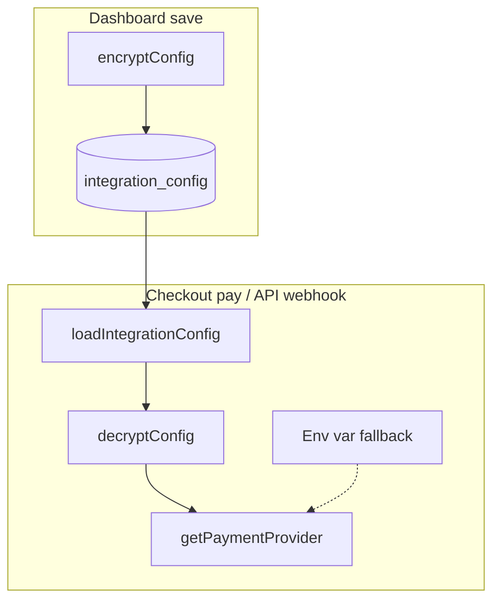

The dashboard **Integrations** section lets merchants configure provider credentials that override environment-level defaults. Credentials are encrypted at rest and scoped per organization.

## Integration list

**Route:** `/integrations`

Shows available providers grouped by category:

| Category | Providers |
| --- | --- |
| **Payments** | Stripe, Easypay, Ifthenpay |
| **Notifications** | Resend, SMTP (UI only — no runtime factory yet) |
| **Analytics** | Google Analytics 4 (UI only) |

Each provider card shows connection status (configured / not configured).

## Provider configuration

**Route:** `/integrations/[provider]`

Dynamic form rendered from the provider registry in `lib/providers.ts`. It shows the store's webhook URL, because orders are only marked as paid when the provider calls it. The dashboard needs `CHECKOUT_URL` to build that URL.

Saving a new provider enables it. Stripe and Easypay keys are tested with a read-only call on save; Ifthenpay has no such call.

Each provider defines its configurable fields:

### Stripe

| Field | Env fallback | Description |
| --- | --- | --- |
| `secretKey` | `STRIPE_SECRET_KEY` | Server-side secret key |
| `webhookSecret` | `STRIPE_WEBHOOK_SECRET` | Webhook signing secret (required) |
| `publishableKey` | `NEXT_PUBLIC_STRIPE_PUBLISHABLE_KEY` | Client-side publishable key |

### Easypay

| Field | Env fallback | Description |
| --- | --- | --- |
| `accountId` | `EASYPAY_ACCOUNT_ID` | Easypay account ID |
| `apiKey` | `EASYPAY_API_KEY` | API key |
| `baseUrl` | `EASYPAY_BASE_URL` | API base URL (prod/sandbox) |

### Ifthenpay

| Field | Env fallback | Description |
| --- | --- | --- |
| `antiPhishingKey` | `IFTHENPAY_ANTIPHISHING_KEY` | Anti-phishing key |
| `mbKey` | `IFTHENPAY_MB_KEY` | Multibanco key (required) |
| `mbwayKey` | `IFTHENPAY_MBWAY_KEY` | MB WAY key |
| `ccKey` | `IFTHENPAY_CC_KEY` | Credit card key |

## How credentials flow



## Storage schema

```sql
CREATE TABLE integration_config (
  id          TEXT PRIMARY KEY,
  organization_id TEXT NOT NULL,
  provider    TEXT NOT NULL,  -- 'stripe', 'easypay', 'ifthenpay'
  config      JSONB NOT NULL, -- encrypted key-value pairs
  created_at  TIMESTAMPTZ,
  updated_at  TIMESTAMPTZ,
  UNIQUE (organization_id, provider)
);
```

## Server actions

`app/(dashboard)/integrations/actions.ts`:

```ts
'use server'
export async function saveIntegration(provider: string, config: Record<string, string>) {
  return withActiveOrg(async (orgId) => {
    const encrypted = encryptConfig(config)
    await upsertIntegrationConfig(orgId, provider, encrypted)
  })
}
```

## Security

- Credentials encrypted with AES-256-GCM (`enc:v1:` prefix)
- Encryption key: `INTEGRATION_ENCRYPTION_KEY` (dedicated key in production)
- Dashboard decrypts on read for form display; never exposes raw secrets to client
- Commerce layer decrypts when building providers at runtime
- Plaintext values (no `enc:v1:` prefix) supported for dev/migration

## Related pages

<Cards>
  <Card title="Payment integration guide" href="/docs/guides/payment-integration" description="End-to-end payment setup." />
  <Card title="Payment packages" href="/docs/packages/payments/stripe" description="Stripe provider details." />
  <Card title="Multi-tenant payments" href="/docs/architecture/multi-tenant" description="Per-tenant credential isolation." />
</Cards>
