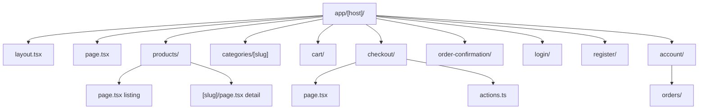

The storefront uses Next.js App Router with server components for catalog pages and client components for interactive cart/search UI.

Every store is served from one route tree under `app/[host]/`. `proxy.ts` rewrites `/{path}` to `/{host}{path}`, so each store's pages are built and cached separately, keyed by its host. Pages read the host with `host()` from `next/root-params`; Route Handlers and Server Actions, which have no root params, read the `Host` header with `requestHost()` from `lib/store-host.ts`.

## Page routes

| Route | Type | Description |
| --- | --- | --- |
| `/` | Server | Home — hero banner, featured products, category links |
| `/products` | Server | Product listing with search query and sort params |
| `/products/[slug]` | Server | Product detail — gallery, variant selector, add-to-cart |
| `/categories/[slug]` | Server | Category-filtered product grid |
| `/cart` | Server + Client | Full cart page with summary and checkout CTA |
| `/checkout` | Server + Client | Checkout form — customer info, shipping address, place order |
| `/order-confirmation` | Server | Post-payment order summary (query param: order ID) |
| `/login` | Client | Customer login form |
| `/register` | Client | Customer registration form |
| `/account` | Server | Account overview — profile info, recent orders |
| `/account/orders` | Server | Full order history (requires auth) |

Catalog pages have no `loading.tsx`. Each page wraps its content in `<Suspense>` with a skeleton, so the store's header and footer form a static shell that's shown at once, even for a product that hasn't been built yet.

### For search engines and agents

| Route | Purpose |
| --- | --- |
| `/robots.txt` | Allows the catalog, disallows cart, checkout and account, points at the sitemap |
| `/sitemap.xml` | Sitemap index: `pages.xml`, then one `products-N.xml` per 500 products |
| `/sitemap/[file]` | One sitemap file, with product images |
| `/llms.txt` | What the store is and where its Markdown pages are ([llmstxt.org](https://llmstxt.org)) |
| `/index.md`, `/products.md`, `/products/[slug].md`, `/categories/[slug].md` | Markdown versions of the catalog pages |

A catalog page is also served as Markdown when the request's first `Accept` type is `text/markdown`. HTML pages link to their Markdown version with `<link rel="alternate" type="text/markdown">` and carry schema.org JSON-LD: `Product` and `BreadcrumbList` on product pages, `CollectionPage` on categories, `OnlineStore` and `WebSite` (with a `SearchAction`) on the home page.

### Layout structure



## API routes (BFF)

Local BFF routes proxy to the Commerce API where browser UX requires them:

| Route | Methods | Purpose |
| --- | --- | --- |
| `/api/auth/[...all]` | * | Better Auth handler |
| `/api/commerce/cart` | GET, POST | Read existing cart or create new cart |
| `/api/commerce/cart/items` | POST | Add item to cart |
| `/api/commerce/cart/items/[itemId]` | PATCH, DELETE | Update quantity or remove item |
| `/api/commerce/search` | GET | Product search for client search palette |
| `/api/commerce/countries` | GET | Country list for address forms |
| `/api/revalidate` | POST | Expires a store's cached catalog (called by the API and dashboard) |

### Why BFF routes exist

The cart ID is stored in an HTTP-only cookie (`commerce_cart_id`). Client-side cart operations (add to cart from product page, update quantity in drawer) cannot read this cookie directly — the BFF reads it and forwards the request to the API with the correct cart ID and tenant context.

Catalog reads do **not** need BFF routes — they are fetched server-side in React Server Components.

## Components

### Layout

| Component | File | Purpose |
| --- | --- | --- |
| `Header` | `components/header.tsx` | Logo, navigation, search, cart button, auth links |
| `Footer` | `components/footer.tsx` | Store links, legal, social |
| `Search` | `components/search.tsx` | Search palette trigger |
| `CartButton` | `components/cart-button.tsx` | Cart icon with item count badge |
| `MobileMenu` | `components/mobile-menu.tsx` | Responsive navigation drawer |
| `ThemeToggle` | `components/theme-toggle.tsx` | Light/dark mode switch |

### Commerce

| Component | Purpose |
| --- | --- |
| `ConnectedProductGrid` | Server-fetched product grid with add-to-cart |
| `AddToCart` | Variant-aware add-to-cart button |
| `CheckoutFlow` | Multi-step checkout form |

### Providers

| Provider | Purpose |
| --- | --- |
| `AppProviders` | Theme, toast (sonner), cart context wrapper |
| `CartProvider` | Client cart state — syncs with BFF routes |

## Data fetching

Catalog reads live in `lib/catalog.ts`. Each takes the store host explicitly and is a `"use cache"` function; `lib/commerce-data.ts` wraps them with `host()` for pages:

```ts
import { fetchProductList, fetchCategories } from '@/lib/commerce-data'

const [{ products }, categories] = await Promise.all([fetchProductList({ sort, page }), fetchCategories()])
```

Catalog requests send only the store host (`x-storefront-host`), never cookies, so one cached answer serves every shopper. Cart, order and account reads use `getCommerceApi()`, which forwards the session cookie and is never cached.

## Caching

| Data | Cache tag | Expired by |
| --- | --- | --- |
| Products (lists, product pages) | `products-{tenantId}` | Product, variant, inventory and category changes |
| Categories | `categories-{tenantId}` | Category changes |
| Store details | `store-{tenantId}` | Store settings and payment integration changes |

Tags come from `storeCacheTag()` in `@prood/types`. When the API or dashboard changes a store, `@prood/commerce` expires the tags locally and then, after the response, POSTs them to the storefront's `/api/revalidate` with `STOREFRONT_REVALIDATE_SECRET`. The next visit rebuilds the page. If that call fails, entries still expire within an hour.

Free-text search isn't cached: there's no end to the queries. Cart, checkout and account pages are **never cached**: they depend on cookies and session state.

## Not found

Unknown products, categories and policy pages get a real `404` status. `proxy.ts` checks document requests and rewrites misses to the store's not-found page. Paths that match no route at all use `app/global-not-found.tsx` (`experimental.globalNotFound`), because the root layout sits under `[host]`. Hosts with no store redirect to the marketing site.

## Building

With Cache Components, `generateStaticParams` in `app/[host]/layout.tsx` must name at least one host. It names `build.invalid`, a host that is no store's and renders as not found, so `next build` needs neither the database nor the API. Real stores are built on their first visit.

## Related pages

<Cards>
  <Card title="Cart & checkout" href="/docs/apps/storefront/cart-checkout" description="Cart cookie flow and checkout redirect." />
  <Card title="Storefront overview" href="/docs/apps/storefront" description="Architecture and configuration." />
</Cards>
