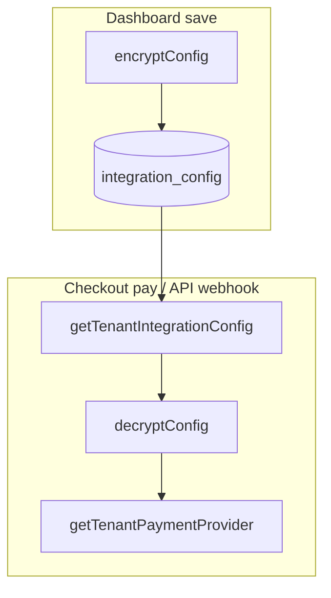

`apps/dashboard` is the merchant admin application. For what merchants see, read the [Dashboard](/docs/apps/dashboard) section.

**Port:** 3002 · **Framework:** Next.js 16 · **Auth:** Better Auth + organization plugin

## Architecture

```mermaid
flowchart TB
  PAGE[Dashboard page]
  SC[Server Component]
  SA[Server Action]
  ADMIN[admin-api.ts]
  API[@prood/api-client]
  REST["API /v1/admin/*"]
  DB["Direct DB<br/>integrations & domains"]
  COM["@prood/commerce.withTenant()"]

  PAGE --> SC --> ADMIN --> API --> REST
  PAGE --> SA --> ADMIN
  PAGE --> DB --> COM
```

Most data operations go through the Commerce API. Integration credentials and domain records are managed directly via Drizzle.

## Routes

| Section | Route | Notes |
| --- | --- | --- |
| Overview | `/` | Stats and setup checklist |
| Orders | `/orders`, `/orders/[id]` | Server actions in `app/(dashboard)/orders/actions.ts` |
| Products | `/products`, `/products/new`, `/products/[id]/edit` | `components/store/product-form.tsx`. Writes go to `/v1/admin/products` |
| Customers | `/customers`, `/customers/[id]` | |
| Domains | `/domains` | `app/(dashboard)/domains/actions.ts`, `lib/vercel.ts` |
| Integrations | `/integrations`, `/integrations/[provider]` | Form built from `lib/providers.ts` |
| API keys | `/settings/api-keys` | Store owners and admins only |
| Team | `/team` | Better Auth organization plugin |
| Store settings | `/settings` | |
| Billing | `/billing` | Shows the current plan |

The sidebar lives in `lib/nav.ts`.

## Auth and organizations

Merchants sign in with email and password. Better Auth's organization plugin provides multi-store support:

- Registration creates a user, a first organization and an `owner` member
- `session.activeOrganizationId` decides which store is shown
- `lib/create-store.ts` uses the store address from the form. If it's taken or reserved, it adds a five-character random suffix, so the address isn't guaranteed to be what was typed
- All admin API calls are scoped to the active organization

```ts
// lib/admin.ts
export async function withActiveOrg<T>(fn: (orgId: string) => Promise<T>) {
  const orgId = await requireActiveOrg()
  return withTenant(orgId, fn)
}
```

Roles are checked by the API on every request. Owners and admins get `admin`, `staff` and `storefront`. Other members get `staff` and `storefront`. See [Authentication](/docs/apps/api/authentication).

## Configuration

| Variable | Purpose |
| --- | --- |
| `DATABASE_URL` | Auth, `integration_config` and `tenant_domain` tables |
| `COMMERCE_API_URL` | Admin API client base URL |
| `BETTER_AUTH_SECRET` | Session validation on SSR (same secret as API) |
| `NEXT_PUBLIC_AUTH_URL` | Browser auth client → `apps/api` (default `http://localhost:3005`) |
| `INTEGRATION_ENCRYPTION_KEY` | Encrypts provider credentials at rest |
| `CHECKOUT_URL` | Builds the webhook URL shown on a provider's page |
| `VERCEL_TOKEN`, `STOREFRONT_VERCEL_PROJECT_ID`, `VERCEL_TEAM_ID` | Custom domain provisioning |
| `NEXT_PUBLIC_PLATFORM_DOMAIN` | Shown on the domains page |

## Credentials

Payment credentials exist only per store. There is no environment fallback.



`PAYMENT_PROVIDER_IDS` in `@prood/commerce` lists providers in checkout preference order: Stripe, Easypay, Ifthenpay. A session uses the first one the store has connected and turned on.

Security:

- Credentials are encrypted with AES-256-GCM (`enc:v1:` prefix) using `INTEGRATION_ENCRYPTION_KEY`, one key for the platform
- The dashboard never sends raw secrets to the client
- The commerce layer decrypts when building a provider at runtime

## Domains

`lib/vercel.ts` wraps the Vercel SDK. Adding a domain inserts a `tenant_domain` row, adds the domain to the storefront's Vercel project and returns the DNS records the merchant must configure (`lib/dns-records.ts`). Once Vercel verifies it, the storefront resolves the organization from that host and Vercel provisions the certificate.

Limits are enforced in `addDomainAction`.

| Variable | Purpose |
| --- | --- |
| `VERCEL_TOKEN` | Vercel API bearer token |
| `STOREFRONT_VERCEL_PROJECT_ID` | Storefront Vercel project ID (store custom domains attach here) |
| `VERCEL_TEAM_ID` | Vercel team ID, if applicable |

`tenantDomain` is defined in `packages/auth/src/schema.ts`. Subdomain resolution happens in `apps/storefront/lib/tenant.ts`. Locally, open `http://prood-demo.localhost:3000` with `NEXT_PUBLIC_PLATFORM_DOMAIN=localhost`.

## Related pages

<Cards>
  <Card title="Multi-tenant platform" href="/docs/architecture/multi-tenant" description="Tenant isolation architecture." />
  <Card title="Order lifecycle" href="/docs/architecture/order-lifecycle" description="The order status model." />
  <Card title="Authentication" href="/docs/apps/api/authentication" description="Sessions, scopes and keys." />
</Cards>
