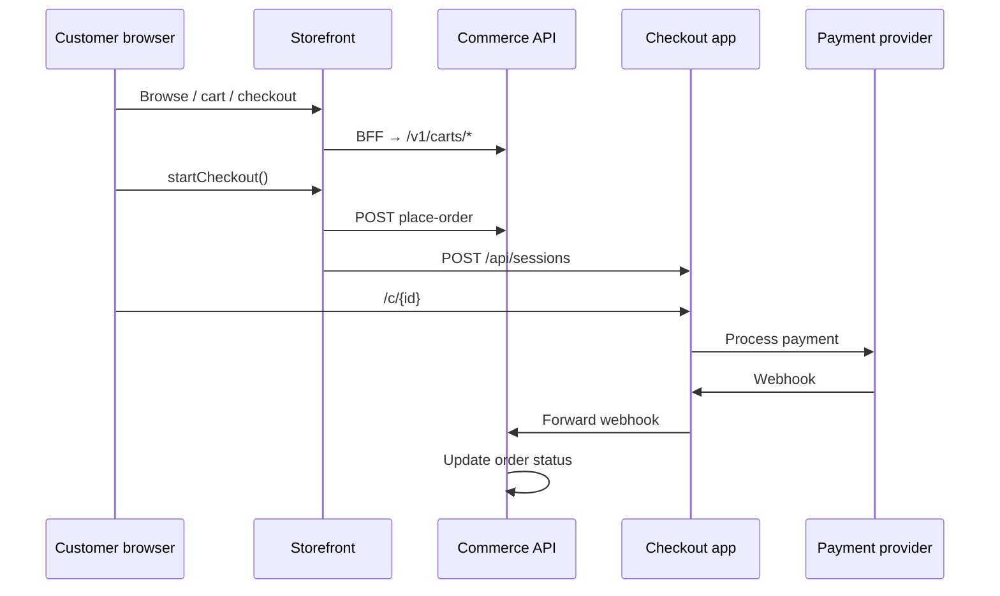

This guide walks through the **end-to-end customer flow** using the default local setup. No code changes required — just env vars and running servers.

## Before you start

Ensure you have completed [Installation](/docs/getting-started/installation):

- `pnpm db:migrate` and `pnpm db:seed` completed successfully
- `pnpm dev` running (or at least storefront `:3000`, checkout `:3004`, api `:3005`)
- `NEXT_PUBLIC_PLATFORM_DOMAIN=localhost` in `.env.local`, so the demo store is served at `prood-demo.localhost:3000`

For live payments, also configure Stripe (or another provider) and Upstash Redis. Without Redis, checkout session creation will fail.

## Step 1 — Browse the storefront

Open [http://localhost:3000](http://localhost:3000).

The home page loads featured products and categories. Catalog data is fetched from the Commerce API and cached per tenant with Next.js Cache Components (`'use cache'` + tenant-scoped cache tags).

Navigate to **Products** to see the full catalog with search and sort.

## Step 2 — Add items to the cart

Click **Add to cart** on any product. The storefront:

1. Reads or creates a cart via the local BFF route `POST /api/commerce/cart/items`
2. Stores the cart ID in an HTTP-only cookie (`commerce_cart_id`, 30-day TTL)
3. Updates the cart drawer UI via React context

Open the cart drawer (header icon) to review items, adjust quantities, or apply a coupon.

## Step 3 — Start checkout

Go to `/checkout` or click **Checkout** in the cart drawer.

The checkout page collects:

- Customer email and name
- Shipping address (when fulfillment requires shipping)
- Billing address (optional)

When you submit, the server action `startCheckout()` in `apps/storefront/app/checkout/actions.ts`:

1. Calls the API `POST /v1/carts/{id}/place-order` to create an order
2. Creates a checkout session on `apps/checkout` via `POST /api/sessions`
3. Redirects the browser to `http://localhost:3004/c/{sessionId}`

## Step 4 — Complete payment

On the checkout app payment page:

| Provider | Experience |
| --- | --- |
| **Stripe** | Embedded Payment Element — enter test card `4242 4242 4242 4242` |
| **Easypay** | Reference-based — Multibanco entity/reference or MB WAY |
| **Ifthenpay** | Reference-based — Multibanco, MB WAY, or card redirect |

After successful payment, you are redirected to `/confirm/{sessionId}` and then back to the storefront order confirmation page.

## Step 5 — Verify in the dashboard

Sign in to the merchant dashboard at [http://localhost:3002](http://localhost:3002).

Use the admin credentials from `ADMIN_EMAIL` / `ADMIN_PASSWORD` (set during seed), or register a new merchant account.

Navigate to **Orders** to see the order you just placed. You can fulfill, refund, or view order details.

## What happened under the hood



## API quick test

You can also interact with the API directly:

```bash
# Health check
curl http://localhost:3005/v1/health

# List the demo store's products (tenant from the storefront host)
curl -H "x-storefront-host: prood-demo.localhost" http://localhost:3005/v1/products

# OpenAPI spec
curl http://localhost:3005/v1/openapi.json
```

Browse the interactive reference at [Commerce API](/docs/api).

## Next steps

<Cards>
  <Card title="Storefront guide" href="/docs/apps/storefront" description="Deep dive into pages, cart BFF, and tenant resolution." />
  <Card title="Checkout guide" href="/docs/apps/checkout" description="Sessions, Redis, payment providers, and webhooks." />
  <Card title="Payment integration" href="/docs/guides/payment-integration" description="Configure Stripe, Easypay, or Ifthenpay per tenant." />
  <Card title="Multi-tenancy" href="/docs/architecture/multi-tenant" description="How organizations, domains, and RLS isolate merchant data." />
</Cards>
