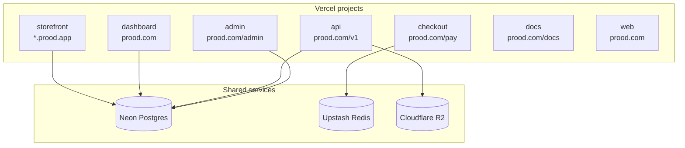

Prood deploys as **separate Vercel projects** sharing a single Neon Postgres database. Each app has its own environment variables and build configuration.

## One domain, one project per app

prood.com is one domain with a path per app. `apps/web` owns it: its own pages are the marketing site, and rewrites in `apps/web/next.config.ts` send every other path to the Vercel project that serves it, so the address bar never leaves prood.com.

The dashboard is the root of the domain. Signed in, `prood.com` is your store's overview, and `/orders`, `/products`, `/customers` and the rest sit right under it. Signed out, `prood.com` is the marketing homepage. A signed-in visitor reaches the homepage at `/home`, from the dashboard's account menu.

| Address | App | Vercel project |
| --- | --- | --- |
| `prood.com` | Marketing (`apps/web`) when signed out, and the gateway for the paths below | `prood-web` |
| `prood.com` when signed in, and `/login`, `/register`, `/orders`, `/products`, `/customers`, `/payments`, `/domains`, `/team`, `/billing`, `/settings`, `/account` and a few more | Merchant dashboard | `prood-dashboard` |
| `prood.com/admin` | Platform admin | `prood-admin` |
| `prood.com/pay` | Hosted checkout, and the payment webhooks at `/pay/api/webhooks/{provider}/{orgId}` | `prood-checkout` |
| `prood.com/docs` | Documentation | `prood-docs` |
| `prood.com/v1`, `/mcp`, `/api/auth`, `/.well-known/agent-configuration` | Commerce API, MCP, sign-in API, Agent Auth discovery | `prood-api` |
| `{slug}.prood.app` | Storefront (wildcard on the storefront project) | `prood-storefront` |
| `shop.example.com` | Store custom domain (per merchant) | `prood-storefront` |

Each app keeps its own Vercel project and its own `*.vercel.app` address. Only `prood-web` has the prood.com domain. The other projects are reached through it, so they need no domain of their own, and a browser never sees their addresses.

Merchant stores stay on `prood.app`, a different registrable domain, on purpose. Merchants publish their own pages, and a browser treats everything on one domain as related. Keeping stores on another domain means store content shares no cookies or storage with the dashboard, the admin console or the sign-in API.

Set `NEXT_PUBLIC_PLATFORM_DOMAIN=prood.app` for storefront subdomain resolution only.

### How the gateway finds each app

`prood-web` rewrites each path to the project behind it, using five variables set on that project only:

| Variable | Value | Receives |
| --- | --- | --- |
| `DASHBOARD_ORIGIN` | `https://<dashboard project>.vercel.app` | `/` for a signed-in visitor, the paths in `DASHBOARD_SEGMENTS` (`apps/web/lib/zones.ts`), `/api/export`, `/_dashboard/_next` |
| `ADMIN_ORIGIN` | `https://<admin project>.vercel.app` | `/admin` |
| `DOCS_ORIGIN` | `https://<docs project>.vercel.app` | `/docs`, `/docs.md`, `/_docs/_next`, `/api/search` |
| `CHECKOUT_ORIGIN` | `https://<checkout project>.vercel.app` | `/pay` |
| `API_ORIGIN` | `https://<api project>.vercel.app` | `/v1`, `/mcp`, `/api/auth`, `/.well-known/agent-configuration` |

Use the origin only, with no path. A build on Vercel fails when one is missing, because a localhost fallback in production would break that whole part of the site silently. Locally they default to the apps' own ports.

The apps know their place on the domain too. The admin console and checkout are built with `basePath` set to `/admin` and `/pay`. The dashboard and the docs load their scripts and styles from `/_dashboard/_next` and `/_docs/_next`. None of them collides with another app's files.

The gateway decides `/` by looking for Better Auth's session cookie, which is `__Secure-better-auth.session_token` on https. It is a hint, not proof: the dashboard still checks the session, and sends a stale cookie to `/login`. The homepage is always at `/home`.

Dashboard pages share the first path segment with nothing in `apps/web`, and a test (`apps/web/lib/__tests__/zones.test.ts`) fails if a marketing page takes one of the names in `DASHBOARD_SEGMENTS`. That is why the dashboard's payment providers page is `/payments`: `/integrations` is a marketing page.

The gateway also redirects the short address `/signup` to `/register`, and the old `/dashboard/...` addresses to the same path without `/dashboard`, so links in old emails still work.

### Adding another app to prood.com

1. Give the new app a `basePath`, or an `assetPrefix` if it must serve a path it doesn't own, so its files can't collide with another app's `/_next`.
2. In `apps/web/next.config.ts`, add a `*_ORIGIN` variable and two rewrites, one for the bare path and one for `/path/:path*`. (More dashboard pages only need a name in `DASHBOARD_SEGMENTS`.)
3. Add the path to the `PROXIED` pattern in the same file. The gateway's security headers apply to its own pages only, because each app sends its own Content-Security-Policy.
4. Add the variable to `globalEnv` in `turbo.json`.
5. Set the variable on the `prood-web` project, then redeploy it.

## Deployment architecture



## Prerequisites

1. Vercel account with team/project access
2. Neon Postgres provisioned (Vercel marketplace integration)
3. Upstash Redis provisioned (Vercel marketplace integration)
4. Payment provider accounts (Stripe, Easypay, and/or Ifthenpay)
5. Domain names configured

## Step 1 — Database setup

Apply the versioned migrations to the production database (and again on every
deploy that adds migrations; already-applied ones are skipped):

```bash
# Set DATABASE_URL to the production Neon connection string
DATABASE_URL="postgresql://..." pnpm db:migrate
```

This creates the commerce and Better Auth tables, the `prood_app` role and the
row-level-security policies. The role that runs the migrations must be able to
create roles (the Neon owner role can) and must be the role the apps connect
with, because `0000_app_role` grants `prood_app` to it. Postgres 16 or later is
required. If `prood_app` already exists under another owner, a superuser must
first run `GRANT prood_app TO <migrating_role> WITH ADMIN OPTION`. Only run
`pnpm db:seed` if you want the demo store.

## Step 2 — Deploy the API

The API must be deployed first — other apps depend on it.

| Setting | Value |
| --- | --- |
| Framework | Next.js |
| Root directory | `apps/api` |
| Build command | `cd ../.. && pnpm build --filter=api` |
| Node.js version | 24 |

### Environment variables

```bash
DATABASE_URL=postgresql://...
BETTER_AUTH_SECRET=<openssl rand -base64 32>
AUTH_PROXY_SECRET=<openssl rand -base64 32>
BETTER_AUTH_URL=https://prood.com
KV_REST_API_URL=https://...
KV_REST_API_TOKEN=...
NEXT_PUBLIC_WEB_URL=https://prood.com
NEXT_PUBLIC_DASHBOARD_URL=https://prood.com
NEXT_PUBLIC_ADMIN_URL=https://prood.com/admin
NEXT_PUBLIC_DOCS_URL=https://prood.com
API_PUBLIC_URL=https://prood.com
PASSKEY_RP_ID=prood.com
PASSKEY_ORIGINS=https://prood.com
S3_ENDPOINT=https://<account>.eu.r2.cloudflarestorage.com
S3_BUCKET=prood-public
S3_ACCESS_KEY_ID=...
S3_SECRET_ACCESS_KEY=...
S3_PUBLIC_URL=https://prood-media.rbarona.workers.dev
# Also set S3_PUBLIC_URL on storefront, dashboard, admin and checkout: next/image
# reads it at build time and rejects the host without it.
CHECKOUT_API_SECRET=<shared secret>
INTEGRATION_ENCRYPTION_KEY=<openssl rand -base64 32>
RESEND_API_KEY=re_...
RESEND_FROM_EMAIL="Prood <noreply@prood.com>"
NEXT_PUBLIC_PLATFORM_DOMAIN=prood.app
```

`BETTER_AUTH_URL` and `API_PUBLIC_URL` are the public address, `https://prood.com`, not this project's `*.vercel.app` address: Better Auth builds its links and checks the origin of every sign-in against them, and the Agent Auth discovery document advertises them.

Leave `AUTH_COOKIE_DOMAIN` unset. The dashboard, the admin console and the API share one host, so the session cookie is already shared, and no other subdomain needs it.

Passkeys are on when `PASSKEY_RP_ID` and `PASSKEY_ORIGINS` are both set, and off when both are empty. Set them to the same values on `prood-api`, `prood-dashboard` and `prood-admin`. The ID must be a registrable domain, so it can't be a `*.vercel.app` address.

## Step 3 — Deploy the storefront

| Setting | Value |
| --- | --- |
| Root directory | `apps/storefront` |
| Build command | `cd ../.. && pnpm build --filter=storefront` |

### Environment variables

```bash
DATABASE_URL=postgresql://...
COMMERCE_API_URL=https://<api project>.vercel.app/v1
BETTER_AUTH_SECRET=<same as API>
KV_REST_API_URL=<same as API>
KV_REST_API_TOKEN=<same as API>
CHECKOUT_URL=https://prood.com/pay
CHECKOUT_API_SECRET=<same as API>
RESEND_API_KEY=re_...
RESEND_FROM_EMAIL="Prood <noreply@casalume.example>"
NEXT_PUBLIC_PLATFORM_DOMAIN=prood.app
```

Custom domains are added per-merchant via the dashboard Domains page.

## Step 4 — Deploy the checkout app

| Setting | Value |
| --- | --- |
| Root directory | `apps/checkout` |
| Build command | `cd ../.. && pnpm build --filter=checkout` |

### Environment variables

```bash
KV_REST_API_URL=https://...
KV_REST_API_TOKEN=...
CHECKOUT_API_SECRET=<same as API>
CHECKOUT_URL=https://prood.com/pay
COMMERCE_API_URL=https://<api project>.vercel.app/v1
```

Payment credentials aren't environment variables. Each store enters its own under Payments in the dashboard, and there is no platform fallback.

`CHECKOUT_URL` is the public base including its path. The storefront, the dashboard and the checkout all build their links from it, so it is `https://prood.com/pay`, not `https://prood.com`.

Configure payment webhooks to: `https://prood.com/pay/api/webhooks/{provider}/{orgId}`. The webhook URL in each store's provider settings is built from `CHECKOUT_URL`, so a store that registered an older address must register this one again.

## Step 5 — Deploy the dashboard

| Setting | Value |
| --- | --- |
| Root directory | `apps/dashboard` |
| Build command | `cd ../.. && pnpm build --filter=dashboard` |

### Environment variables

```bash
DATABASE_URL=postgresql://...
COMMERCE_API_URL=https://<api project>.vercel.app/v1
BETTER_AUTH_SECRET=<same as API>
AUTH_PROXY_SECRET=<same as API>
BETTER_AUTH_URL=https://prood.com
NEXT_PUBLIC_AUTH_URL=https://<api project>.vercel.app
NEXT_PUBLIC_DASHBOARD_URL=https://prood.com
NEXT_PUBLIC_API_URL=https://prood.com
NEXT_PUBLIC_DOCS_URL=https://prood.com
CHECKOUT_URL=https://prood.com/pay
PASSKEY_RP_ID=prood.com
PASSKEY_ORIGINS=https://prood.com
INTEGRATION_ENCRYPTION_KEY=<same as API>
VERCEL_TOKEN=<for domain provisioning>
STOREFRONT_VERCEL_PROJECT_ID=<storefront project ID>
VERCEL_TEAM_ID=<team ID>
NEXT_PUBLIC_PLATFORM_DOMAIN=prood.app
```

Dashboard auth (sign-in, sign-up, organization ops) is issued by **apps/api**. The browser calls `/api/auth/*` on prood.com, and the gateway sends it to the API project, so the session cookie belongs to prood.com. The admin console reaches the API through its own proxy at `/admin/api/auth/*`, which uses `NEXT_PUBLIC_AUTH_URL`, that project's own `*.vercel.app` address. The two `*.vercel.app` addresses (`COMMERCE_API_URL` and `NEXT_PUBLIC_AUTH_URL`) are only for server-to-server calls; a browser never uses them.

## Step 6 — Deploy the platform admin

| Setting | Value |
| --- | --- |
| Root directory | `apps/admin` |
| Build command | `cd ../.. && pnpm build --filter=admin` |

### Environment variables

```bash
DATABASE_URL=postgresql://...
BETTER_AUTH_SECRET=<same as API>
AUTH_PROXY_SECRET=<same as API>
BETTER_AUTH_URL=https://prood.com
API_PUBLIC_URL=https://prood.com
NEXT_PUBLIC_AUTH_URL=https://<api project>.vercel.app
NEXT_PUBLIC_ADMIN_URL=https://prood.com/admin
PASSKEY_RP_ID=prood.com
PASSKEY_ORIGINS=https://prood.com
```

`apps/admin` is for platform operations only. Access is limited to users with the `admin` role.

The admin console is on the same origin as the dashboard, so a session started at the dashboard is also valid at `/admin`, and a platform administrator who signs in at the dashboard is signed in to both. Two-factor sign-in is optional for administrators, and the console shows a banner until it is on. Turn on two-factor or add a passkey on every administrator account. Prood does not remember devices, so the code is asked for at each sign-in.

## Step 7 — Deploy docs and web

| App | Root directory | Notes |
| --- | --- | --- |
| `docs` | `apps/docs` | Runs `sync:openapi` at build time |
| `web` | `apps/web` | Marketing site, and the gateway for every other path |

```bash
# Docs
NEXT_PUBLIC_WEB_URL=https://prood.com
NEXT_PUBLIC_DOCS_URL=https://prood.com
NEXT_PUBLIC_DASHBOARD_URL=https://prood.com
NEXT_PUBLIC_API_URL=https://prood.com

# Web
NEXT_PUBLIC_WEB_URL=https://prood.com
NEXT_PUBLIC_DOCS_URL=https://prood.com
NEXT_PUBLIC_DASHBOARD_URL=https://prood.com
NEXT_PUBLIC_API_URL=https://prood.com
DASHBOARD_ORIGIN=https://<dashboard project>.vercel.app
ADMIN_ORIGIN=https://<admin project>.vercel.app
DOCS_ORIGIN=https://<docs project>.vercel.app
CHECKOUT_ORIGIN=https://<checkout project>.vercel.app
API_ORIGIN=https://<api project>.vercel.app
```

Deploy `web` last: it needs the other projects' addresses.

## Step 8: Point the domain at the web project

1. Add `prood.com` to the `prood-web` project and set it as the production domain.
2. Add no domain to the other projects. They stay on their `*.vercel.app` addresses, which only the gateway uses.
3. Add `prood.app` and `*.prood.app` to the storefront project, as before.
4. Open the addresses in the verification list below.

Traffic to the old subdomains (`dashboard.prood.com`, `api.prood.com`, `checkout.prood.com`, `docs.prood.com`, `admin.prood.com`) is not served any more. Remove those domains from their projects. If you want old links to keep working, add redirects on `prood-web` from each hostname to the matching path; nothing in the repo does this.

## Verify the deployment

| Address | Expect |
| --- | --- |
| `https://prood.com/login` | The dashboard sign-in page |
| `https://prood.com/` | The marketing homepage when signed out, the dashboard when signed in |
| `https://prood.com/admin/login` | The admin sign-in page |
| `https://prood.com/docs` | These docs |
| `https://prood.com/pay/c/x` | The checkout app's page for an unknown session, not the marketing site |
| `https://prood.com/v1/health` | The API's health response |
| `https://prood.com/.well-known/agent-configuration` | The Agent Auth discovery document, with `https://prood.com` addresses |

Then sign in at the dashboard, turn on two-factor, add a passkey on a real device, and take a test payment through `/pay` with a store connected to Stripe test mode.

An address on a `*.vercel.app` host (a bookmark to an app's own project) isn't the product's address any more. Use prood.com. Payment providers that were given a webhook URL on the old checkout host need the new `https://prood.com/pay/api/webhooks/{provider}/{orgId}` registered.

## Local development through the gateway

Locally the gateway is `apps/web` on port 3001, and it stands in for prood.com. Open it, not each app's own port, so the dashboard, admin console, checkout, docs and API share one origin as they do in production:

| Address | App |
| --- | --- |
| `http://localhost:3001` | Marketing |
| `http://localhost:3001/login` | Dashboard (`http://localhost:3001` once signed in) |
| `http://localhost:3001/admin` | Admin |
| `http://localhost:3001/docs` | Docs |
| `http://localhost:3001/pay` | Checkout |
| `http://localhost:3001/v1/health` | API |

The apps listen on 3002 (dashboard), 3003 (docs), 3004 (checkout), 3005 (api) and 3006 (admin), and the gateway's `*_ORIGIN` variables default to those ports. `pnpm env:link` writes the matching URL variables into each app. See [Environment variables](/docs/run-locally/environment).

## Shared secrets

These must be **identical** across projects:

| Secret | Apps |
| --- | --- |
| `BETTER_AUTH_SECRET` | API, dashboard (SSR session validation), admin, storefront |
| `AUTH_PROXY_SECRET` | API, dashboard, admin |
| `CHECKOUT_API_SECRET` | API, storefront, checkout |
| `INTEGRATION_ENCRYPTION_KEY` | API, dashboard |
| `DATABASE_URL` | API, storefront, dashboard, admin |
| `KV_REST_API_URL`, `KV_REST_API_TOKEN` | API, storefront, checkout |

## Caching in production

The storefront uses Next.js Cache Components:

- Catalog pages: `'use cache'` with per-tenant tags
- Cart/checkout/account: dynamic (cookie/session dependent)
- Cache invalidation: dashboard product updates trigger `revalidateTag` via API

## Production checklist

- Strong secrets generated for `BETTER_AUTH_SECRET`, `AUTH_PROXY_SECRET`, `CHECKOUT_API_SECRET`, `INTEGRATION_ENCRYPTION_KEY`
- `NEXT_PUBLIC_PLATFORM_DOMAIN` configured
- Upstash Redis provisioned for checkout and auth rate limits, with `KV_REST_API_URL` and `KV_REST_API_TOKEN` set on API, storefront and checkout
- Payment webhooks pointed to `https://prood.com/pay/api/webhooks/{provider}/{orgId}`
- `prood-web` has all five `*_ORIGIN` variables, and every project uses the one-domain URL values above
- `AUTH_COOKIE_DOMAIN` is unset, and the passkey variables are set on API, dashboard and admin
- Two-factor or a passkey is on for every platform administrator
- Resend sender uses a verified production domain
- `pnpm db:migrate` run against production database
- Custom domains verified for at least one merchant
- SSL certificates active on prood.com, prood.app and its wildcard

## Related pages

<Cards>
  <Card title="Environment variables" href="/docs/run-locally/environment" description="Complete env var reference." />
  <Card title="Webhook setup" href="/docs/guides/webhook-setup" description="Configure payment webhooks." />
  <Card title="Payment integration" href="/docs/guides/payment-integration" description="Payment provider setup." />
</Cards>
