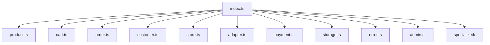

`@prood/types` is the **shared vocabulary** for all Prood packages. It contains TypeScript interfaces and types only — no runtime code, no dependencies.

## Installation

```bash
pnpm add @prood/types
```

Already included as a dependency of `@prood/commerce`, `@prood/platform`, and `@prood/ui`.

## Domain types

### Catalog

```ts
import type {
  Product,
  ProductVariant,
  ProductOption,
  Category,
  Brand,
  SearchResult,
  SearchParams,
} from '@prood/types'
```

### Cart & checkout

```ts
import type {
  Cart,
  CartItem,
  CartTotals,
  ShippingMethod,
  PaymentMethod,
  Address,
  CustomerInfo,
} from '@prood/types'
```

### Orders

```ts
import type {
  Order,
  OrderItem,
  OrderStatus,
  FulfillmentStatus,
} from '@prood/types'
```

### Store & customers

```ts
import type { StoreInfo, Customer, Country } from '@prood/types'
```

## Adapter interfaces

```ts
import type {
  CommerceAdapter,
  CatalogAdapter,
  CartAdapter,
  CheckoutAdapter,
  OrdersAdapter,
  CustomersAdapter,
  StoreAdapter,
} from '@prood/types'
```

Implement these to create a custom commerce backend adapter.

## Provider interfaces

```ts
import type {
  PaymentProvider,
  PaymentSession,
  CreatePaymentSessionInput,
  RefundInput,
  PaymentWebhookEvent,
  StorageProvider,
  UploadInput,
  UploadResult,
} from '@prood/types'
```

## Error handling

```ts
import { CommerceError, toErrorResponse } from '@prood/types'

// Throw structured errors
throw new CommerceError('Product not found', 'NOT_FOUND', 404)

// Convert to HTTP response
const { error, code, status } = toErrorResponse(err)
```

## Admin types

Input/output types for dashboard and admin API operations:

```ts
import type {
  CreateProductInput,
  UpdateProductInput,
  DashboardStats,
  FulfillOrderInput,
  RefundOrderInput,
} from '@prood/types'
```

## Specialized domains

Types for advanced commerce patterns:

```ts
import type {
  Subscription, SubscriptionPlan,
  ReturnRequest,
} from '@prood/types'
```

## Package structure



## Related pages

<Cards>
  <Card title="Unified types (architecture)" href="/docs/architecture/unified-types" description="Conceptual overview of the type system." />
  <Card title="@prood/platform" href="/docs/packages/platform" description="Built-in adapter implementing these interfaces." />
</Cards>
